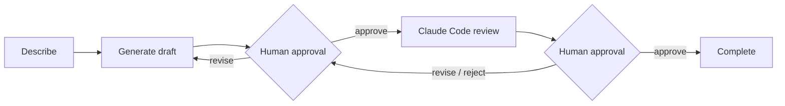

# AI Coding Workbench

A Windows desktop app that turns a project description into a working codebase in two supervised steps. A language model writes a first draft, and Claude Code then reviews, fixes and tests it. Neither step's output is accepted until a person approves it.

**Stack:** Tauri 2 · Rust · React · TypeScript · SQLite · Vite · Vitest
**Status:** working prototype, used locally on Windows 11. Source is private.

## Workflow

## Engineering highlights

- **The backend enforces the approval gates, not the UI.** A transition table in Rust defines the only legal state changes, and each change is checked inside a SQLite transaction. An approval is tied to the exact version ID and SHA-256 content hash the user saw. If the files change afterwards, the approval is revoked automatically.
- **Model output is treated as data, never executed.** Drafts arrive as a JSON manifest. Before anything is written, the app validates every path: it rejects absolute paths, `..`, Windows device names, alternate data streams and writes into `.git` or dependency folders. Writes are all-or-nothing, and drafts are capped by file count and size.
- **Recovery path for incomplete model replies.** A reply that can't be parsed gets one repair request. Files that are missing from the plan get up to three targeted continuation requests. A reply that was cut off fails clearly instead of being half-written.
- **Immutable snapshots.** Each draft and candidate is stored as a read-only snapshot. Restores always come from snapshots, and the current workspace is copied to a recovery folder first if it doesn't match a known version.
- **Least privilege for the reviewer.** Claude Code runs headless with permission prompts turned off, so anything that would need a prompt is denied. Bypass modes are refused in code, and the default allow-list is file tools only.
- **Secrets handling.** The gateway API key lives in Windows Credential Manager. It is never sent to the UI, written to the database or committed, and it is scrubbed from logs and saved responses.

## Verification

- The UI test suite (Vitest, 11 tests), TypeScript type check and production build pass.
- The Rust integration tests cover the workflow state machine. Building them on my current machine is blocked by Windows Smart App Control, which is documented in the project's troubleshooting guide.

## Known limits

Subprocesses aren't sandboxed: commands the user approves run with the user's own rights. Generated code is untrusted until it has been read. These limits are spelled out in the project's security document.
