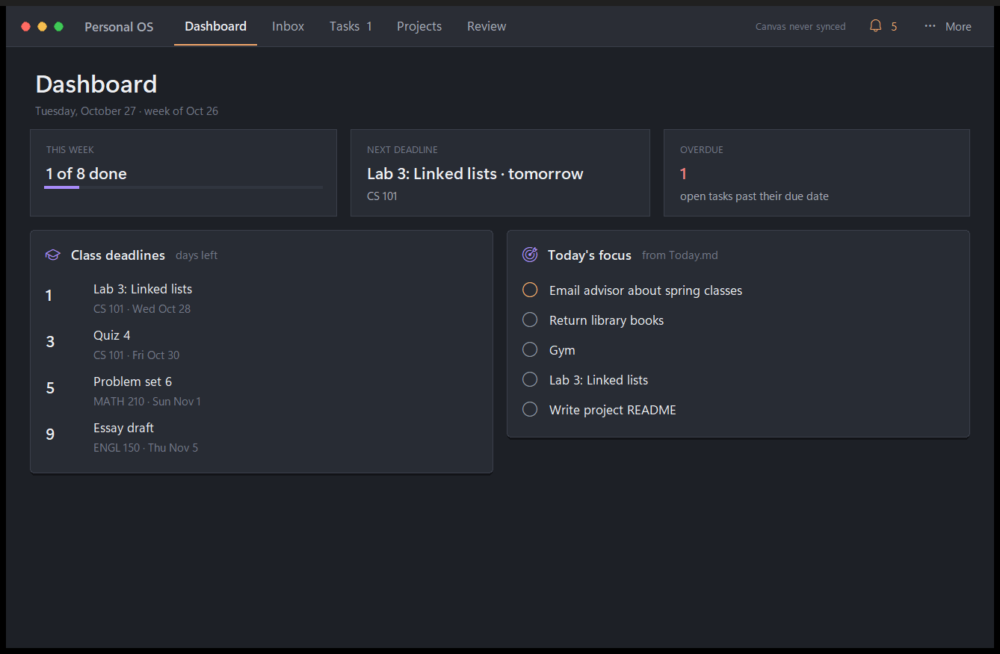
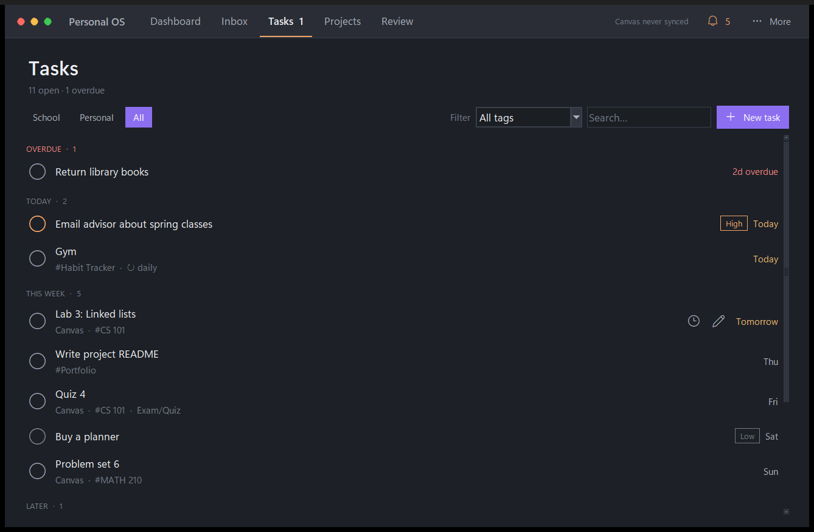

# Personal OS

A Windows desktop planner for the things a student has to keep track of: class deadlines, tasks, a daily check-in, a weekly review, bills and job applications. All data lives as plain Markdown in an Obsidian vault, so it stays readable and editable without the app.

**Stack:** Python 3 · Tkinter · pystray · Pillow · tzdata · unittest
**Status:** in daily personal use. Source is private because it is built around my own workflows. Built with AI-assisted development (Claude Code).

*Screenshots use the repository's fake sample vault.*

## What it does

- **Dashboard:** three summary tiles (tasks done this week, next class deadline, overdue count) above a class-deadline countdown and today's focus list. It fits the window and never scrolls; below 900 px wide the two lists stack.
- **Tasks:** School, Personal and All tabs, each one list split into Overdue, Today, This week, Later and No date, with priority, tag, repeat and exam/quiz badges.
- **Inbox and daily check-in:** new tasks are `- [ ]` lines appended to an Inbox note, with tokens for due date, priority, tags and repeats (`every:day`, `every:mon,thu`). A once-a-day check-in shows today's deadlines, offers to move yesterday's unfinished tasks, and adds new ones without creating duplicates.
- **School:** read-only import of Canvas LMS assignments from the calendar feed, with due times converted to Pacific Time.
- **Weekly review:** what got done, what slipped and what carries over.
- **Project audit:** a read-only report of each of my project folders: git state, GitHub remote, unpushed work and how well the README follows my documentation style guide.
- **Also:** bills and budget, a job-application tracker, a tray icon, a desktop widget and reminders, and an optional AI assistant (Claude through the Claude Code CLI, with a local Ollama model as fallback) whose output is always a proposal I review.

## Engineering highlights

- **Markdown as the source of truth, written safely.** Writes are atomic. Text outside the app's data blocks is never touched. An invalid block is reported, never rewritten. If a file changed in Obsidian after the app loaded it, the save stops instead of overwriting.
- **Debugging from measurements.** Trackpad scrolling looked glitchy. Profiling showed small precision-trackpad deltas were being rounded to zero, while each wheel notch jumped about a third of the window across roughly 1,800 separately repainted widgets. The fix: accumulate deltas in pixels, apply them at most once per idle pass, build row buttons lazily, and cap long lists. Tk on Windows still can't double-buffer a scrolling canvas full of widgets, so the Dashboard was redesigned to not scroll at all.
- **Layered design.** The UI never parses Markdown. It calls services (tasks, inbox, check-in, insights, reminders), which call the store. That separation is what lets most of the test suite run without a GUI.
- **Secrets stay out of files.** The Canvas feed link and API keys are read at runtime from Windows Credential Manager. Logs record events and counts only, never task text, amounts or links.
- **Lightweight on purpose.** Tkinter with a custom dark theme instead of a browser-based framework keeps memory use and dependencies small: three direct third-party packages.

## Verification

133 automated tests (unittest) passed on 2026-10-27. They cover the task model and Markdown store, recurrence, the Inbox convention and check-in, Canvas parsing and time zones, dashboard and review figures, and GUI tests that open real Tk windows and launch the app. All of them run against temporary folders, never real data.

## Known limits

Reminders only fire while I'm signed in, by design (no background service). The Canvas feed has no submission status. Pages other than the Dashboard still scroll and can briefly tear during very fast scrolling. Trackpad behavior was measured with simulated input, not a physical trackpad. The app isn't packaged as an installer.
